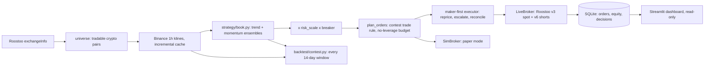

# trend-guard

**A low-volatility trend book plus a long/short momentum book, built for the Roostoo contest score.**

An autonomous trading bot for the Roostoo HK vs AU vs IN Quant Trading Hackathon (Oct 2026). It
runs unattended on EC2, trades the Roostoo mock exchange through its REST API (spot and `/v6`
shorts), and ties every trade to a logged decision and a git commit.

## 1. Overview

One account, three books, with target weights summed per pair:

| Book | Share of account | What it does | Author |
|---|---|---|---|
| **trend-guard v2** | 70% | Two sleeves, each an **ensemble of four parameter sets**. **Trend (70% of v2):** long-only on liquid crypto (including PAXG gold) that is in a clear 1-8 week uptrend, scaled to a low 0.4%/day volatility and rebalanced daily at 12:00 UTC. **Momentum (30% of v2):** long the 6 strongest and short the 6 weakest coins on 3-30 day risk-adjusted momentum, resized hourly to 1.5%/day volatility. | lakshya2109 (`strategy/book.py`) |
| **Trend book** | 21% | Long-only trend on 7/14/30-day horizons, 0.4%/day vol target, volatility trailing stops | Gunek-945 (`strategy/team/`, vendored unmodified) |
| **Momentum book** | 9% | Long/short cross-sectional momentum, 3/7/14-day lookbacks, 1.5%/day vol target | swyam-rd (`strategy/team/`, vendored unmodified) |

The two teammates' books enter together, in their own 70/30 split, as 30% of the account.
Averaging independently built books cancels part of each one's selection noise, which is the same
reason v2's own sleeves are ensembles (docs/STRATEGY.md). Execution is maker-first, and positions
are resized only when the change can pay for its own trading cost.

## 2. Why this design

The composite `0.4 Sortino + 0.3 Sharpe + 0.3 Calmar` over about 14 daily returns barely depends on
book size, punishes a single bad day, and is quickly eaten by fees. So the book diversifies two
return streams that do not lose on the same days, runs at modest volatility, and trades little.
The full research log (what was tried, what failed and why) is in
[`docs/STRATEGY.md`](docs/STRATEGY.md).

## 3. Results

Every 14-day window starting daily at 12:00 UTC from Feb 2024 to Sep 2026, each starting flat in
$100k, 0.10% fee + 5 bps slippage on every trade, contest score on daily marks. This is the same
protocol, data and costs as the team's `roostoo-last-supper` harness, whose published figures are
shown for comparison.

The live book runs the blend at **4x risk** (`book.risk_multiplier: 4.0`, gross capped at 1x equity:
about 97% of equity invested on a median hour), with the momentum sleeves' crash filter (no new shorts
on coins down more than 40% in 60 days). The 2.5x, 2x and 1x rows are earlier settings, kept for comparison:

| 2026 (258 windows) | Score | Median fortnight | P(fortnight > +5%) | Above -1% | Positive | Worst |
|---|---|---|---|---|---|---|
| **trend-guard (blend, 4x risk)** | **0.208** | **+2.85%** | **36%** | 75% | 67% | -8.0% |
| trend-guard (blend, 2.5x risk) | 0.214 | +2.63% | 36% | 77% | 69% | -5.4% |
| trend-guard (blend, 2x risk) | 0.204 | +2.21% | 28% | 78% | 69% | -4.4% |
| trend-guard (blend, 1x risk, before the crash filter) | 0.178 | +0.96% | 10% | 85% | 69% | -2.3% |
| Team combined 70/30 alone | 0.131 | +1.04% | 10% | 84.5% | 69% | -2.3% |
| BTC buy and hold | -0.007 | -0.35% | | 55% | 48% | -18.3% |

| All 944 windows | Score | Median fortnight | P(fortnight > +5%) | P(fortnight < -5%) | Above -1% | Worst |
|---|---|---|---|---|---|---|
| **trend-guard (blend, 4x risk)** | **0.076** | **+1.28%** | **30%** | 9.6% | 67% | -12.2% |
| trend-guard (blend, 2.5x risk) | 0.083 | +1.12% | 26% | 6.0% | 68% | -9.8% |
| trend-guard (blend, 2x risk) | 0.095 | +1.13% | 21% | 3.2% | 69% | -8.1% |
| Team combined 70/30 alone | 0.060 | +0.44% | | | 76% | -5.1% |

More risk buys more return and a bigger upside at the cost of deeper bad fortnights: at 4x the mean
fortnight is +2.5% (+4.0% in 2026), a +10% fortnight comes in 14% of windows, and 9.6% of windows lose
more than 5% (worst -12.2%). The team chose this for a two-week contest where return also screens
teams. More aggressive designs were tested and rejected (docs/STRATEGY.md 15): full-size momentum or
trend books raise the mean a little but the median falls and the loss tail doubles.

**Competition view.** `run_backtest.py` also scores non-overlapping fortnights (no shared days) the way
the previous edition's leaderboard did: daily Sharpe and Sortino, Calmar = total return / max drawdown,
score = active days x normalised ratios, and an estimated rank among that edition's 52 teams
(`backtest/benchmark.py`; their winner had Sharpe 0.19, Sortino 0.25, Calmar 0.95, 11 active days):

| Non-overlapping fortnights (2.5x, before 4x) | 2024 | 2025 | 2026 | All (68) |
|---|---|---|---|---|
| Median fortnight | +0.06% | +1.59% | +3.34% | +1.12% |
| Sharpe / Sortino (daily, median) | 0.01 / 0.02 | 0.12 / 0.20 | 0.20 / 0.42 | 0.08 / 0.13 |
| Calmar, total return / max DD (median) | 0.01 | 0.42 | 1.00 | 0.29 |
| Active days (minimum) | 15 | 15 | 15 | 14 |
| Would have ranked 1st / top 3 among the 52 teams | 57% / 70% | 67% / 78% | 74% / 79% | 62% / 74% |

The rank compares one fortnight with a field that traded a different market (most of last year's teams
lost money), so it shows the bot is competitive, not where it will finish this year.

The edge is real but moderate: 2026 contains only about 18 independent fortnights, so
differences of this size are suggestive rather than conclusive (see docs/STRATEGY.md section 3).
The blend improves on both of its parts in every period. Reproduce with
`python scripts/download_history.py && python backtest/run_backtest.py`.

## 4. Architecture



| Path | Role |
|---|---|
| `src/trend_guard/strategy/book.py` | the strategy: pure functions of the price panel, shared by backtest and live |
| `src/trend_guard/strategy/team/`, `team_book.py` | teammates' books (vendored unmodified, credited in each file) and their adapter |
| `src/trend_guard/execution/order_manager.py` | targets to orders (the contest trade rule), maker-first executor, ambiguous-order reconciliation |
| `src/trend_guard/execution/{broker,live_broker,sim_broker}.py` | one Broker protocol, live Roostoo and simulated implementations |
| `src/trend_guard/roostoo/` | signed REST client (HMAC tested against the documented vector), precision rules, rate limiter |
| `src/trend_guard/data/binance_live.py` | Binance klines with host fallback and an incremental parquet cache |
| `src/trend_guard/risk/breaker.py` | catastrophe circuit breaker |
| `src/trend_guard/engine.py`, `main.py` | 60 s loop, hourly cycle, CLI |
| `backtest/contest.py`, `run_backtest.py`, `sweep.py`, `pbo.py` | contest replay, reports, the design search and its overfitting check |
| `backtest/session.py`, `scripts/simulate.py` | a simulated session over any dates with a full trade log and a leakage check |
| `monitor/dashboard.py` | read-only Streamlit dashboard |
| `deploy/` | systemd units, EC2 setup, logrotate |

## 5. Rule compliance

| Competition rule | Where it is enforced |
|---|---|
| No leverage | `book_weights` asserts sleeve shares sum to <= 1 and each sleeve caps its gross; `plan_orders` spends only free cash plus immediate proceeds, minus a cash buffer |
| Spot and 1x shorts only | longs via `/v3/place_order`; shorts only via `/v6/short_open` sized by collateral (loss capped at collateral by the exchange) |
| No HFT, market making or arbitrage | decisions only on closed hourly Binance bars; one directional order per pair per cycle; no quotes on both sides |
| No manual trading or API calls | every order comes from `engine.Engine`; `scripts/probe_live.py` is gated and runs only through committed code; `.claude/settings.json` denies live mode to the coding assistant |
| No accidental live orders | `main.py` refuses live mode unless `ALLOW_LIVE_ORDERS=1` and keys exist; `LiveBroker._require_live` refuses every order method independently |
| Never blind-retry an order | `RoostooClient._post` never retries order-creating calls; ambiguous outcomes raise `OrderStateUnknownError` and are reconciled via `query_order` (`match_unknown_order`) |
| At least 8 active days | enforced: the book rebalances at 00:00 and 12:00 UTC, and if no fill has landed by :15 in either activity window (00-03 / 12-15 UTC) the engine sends one small MARKET order toward the book's own target (its largest gap, at least 0.1% of equity), retrying hourly. A fill in either window falls on the same date in UTC and HKT, so every contest day (all 15 dates) is active. `order_manager.activity_order`, tests in `tests/test_engine_activity.py` |
| Trade-log integrity | every fill in `logs/fills/*.csv` carries the commit hash; every hourly decision is stored in SQLite and `logs/decisions/*.jsonl` |
| Shorts may be disabled | `ShortsDisabledError` switches the book to long-only for the session |

## 6. Risk management

- Low volatility targets: 0.4%/day for the trend sleeve and 1.5%/day for the momentum sleeve (about
  0.6%/day for the whole book).
- Caps: 50% per trend name; momentum gross at most 0.9x of its capital; account gross at most 1x.
- Liquidity and history filters: at least $2M/day and 14 days (trend), $5M/day and 30 days
  (momentum); stablecoins, tokenized stocks and pairs without a Binance feed are never traded.
- A catastrophe breaker halves every target at a 10% drawdown. Tighter drawdown brakes were tested
  and lowered the score by selling dips before rebounds.
- A HALT file (`/etc/trend-guard/HALT`) cancels resting orders and idles the bot.

## 7. Execution

Every hour at HH:03 UTC (after the Binance candle closes), the bot:
1. tops up the Binance bar cache;
2. computes the book's targets;
3. applies the contest trade rule;
4. places orders: closes first, then maker limits at the touch, repriced every 60 s and sent at
   market after 4 tries.

Shorts open and close at market via `/v6`. Quantities and prices follow each pair's precision and
MiniOrder. Role and commission come from every exchange response. The exchange is the source of
truth: positions are re-read every cycle.

## 8. How to run

```bash
python3.11 -m venv .venv && source .venv/bin/activate      # Windows: .venv\Scripts\activate
pip install -r requirements.txt -r requirements-dev.txt && pip install -e .
cp .env.example .env                                        # keys are only needed for live mode

pytest -q && ruff check .
python scripts/download_history.py                          # hourly bars for every Roostoo crypto pair
python backtest/run_backtest.py                             # contest replay -> reports/<ts>/summary.md
python backtest/sweep.py                                    # the 36-variant design search + PBO
python scripts/simulate.py --start "2026-09-01 12:00" --end "2026-09-15 12:00"  # one simulated session
python -m trend_guard.main --mode paper --once              # one hourly cycle on live prices, simulated fills
python -m trend_guard.main --mode paper                     # run paper trading
ALLOW_LIVE_ORDERS=1 python -m trend_guard.main --mode live  # real orders (operated by a human)
streamlit run monitor/dashboard.py --server.address 127.0.0.1
```

### Simulated session

`scripts/simulate.py --start <UTC> --end <UTC> [--capital 100000] [--out file.txt]` replays the live
book over any dates, starting flat in cash. It prints the return, the contest score and its three
ratios, drawdowns, exposure, fees, turnover, active trading days, daily returns and P&L per pair, and
writes all of that plus every trade (time, pair, BUY/SELL/SHORT/COVER, open/add/reduce/close/flip,
quantity, price, notional, fee, weight before and after, and which sleeves drove it) to
`sim_<start>_<end>.txt` in the current directory. There is no data leakage: no bar after `--end` is
loaded, history is limited to what the live bot loads, and every run recomputes the targets with the
second half of the session deleted and checks the first half is identical (it exits non-zero if not).
Execution is the contest simulator's, trade for trade (`tests/test_session.py`). The backtest's windows
act on the 13:00 close, the session on the exact `--start`, so the two differ slightly for the same day.

## 9. Deployment

On EC2 (Ubuntu, UTC, chrony), the bot runs as a systemd service with `Restart=always`. Secrets
live in `/etc/trend-guard/env` (mode 600), the repo is cloned with a read-only deploy key, and
every deploy is a tagged commit. See [`docs/RUNBOOK.md`](docs/RUNBOOK.md).

## 10. Logs and audit trail

| Artifact | Contents |
|---|---|
| `logs/api/*.jsonl` | every request: path, params (never secrets), success, error |
| `logs/decisions/*.jsonl` + `decisions` table | every hourly cycle: targets, gross/net, multiplier, planned orders, commit |
| `logs/fills/*.csv` | every fill with role, fee, reason and commit hash |
| `orders`, `equity` tables | every order and its status (including `UNKNOWN`), equity every minute |

## 11. Limitations

See [`docs/STRATEGY.md`](docs/STRATEGY.md) section 5. The short version:
- The edge over the team book is moderate and statistically weak on 2026 alone.
- In sharp selloffs the book is positive less than half the time.
- Backtest fills assume the hourly close plus 5 bps.
- The universe carries survivorship bias.

## Credits

The trend book in `src/trend_guard/strategy/team/trend_signal.py` and `trend_portfolio.py` was written by
Gunek-945 ([roostoo-trend-book](https://github.com/Gunek-945/roostoo-trend-book)); the momentum book in
`src/trend_guard/strategy/team/momentum_model.py` was written by swyam-rd (roostoo-last-supper). Both are
included unmodified with their authors' attribution headers.
