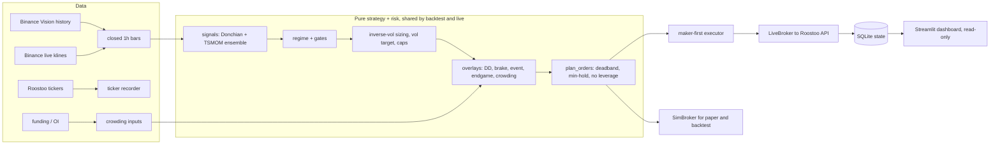

# trend-guard

**TREND-GUARD: a vol-targeted long/short trend ensemble with a drawdown governor.**

An autonomous trading bot for the Roostoo HK vs AU vs IN Quant Trading Hackathon (live 4 to 17 Oct 2026).
It runs unattended on EC2, trades the Roostoo mock exchange through its REST API, and every trade
traces back to a logged decision and a git commit.

## 1. Overview

Every hour, on closed 1-hour bars, the bot scores each liquid Roostoo pair with a **trend ensemble**
(Donchian channel position + volatility-normalised momentum, averaged over six lookbacks from 1 to 21
days). A **market regime** (index trend plus breadth) decides how much long and short risk is
allowed. Positions are sized by **inverse volatility**, scaled jointly to a **30% portfolio volatility
target** using a shrunk covariance matrix, and capped per asset and per sleeve. **Risk overlays**
then only ever shrink the book: a drawdown governor, a daily loss brake, macro-event de-risking, an
end-game lock-in, and a derivatives crowding filter. A 60-second protective loop runs trailing stops
and a shock/squeeze filter. Orders go out **maker-first** (limit at the touch, repriced, then market),
and shorts use Roostoo's `/v6` short endpoints.

## 2. Why this design

In short: crypto trends at 1-to-4-week horizons, volatility scaling is what makes trend-following
work, and the competition's composite score (`0.4 Sortino + 0.3 Sharpe + 0.3 Calmar`) punishes red
days and drawdown far more than it rewards raw return. So the design targets a smooth, positively
skewed equity curve rather than maximum return. See [`docs/STRATEGY.md`](docs/STRATEGY.md) for the
research behind every component (Zarattini et al. 2025, Moskowitz et al. 2012, Barroso & Santa-Clara
2015, Daniel & Moskowitz 2016, Grossman & Zhou 1993, Schmeling et al. 2026, and others).

## 3. Architecture



| Module | Role |
|---|---|
| `src/trend_guard/roostoo/` | REST client: HMAC signing (unit-tested against the docs' vector), clock sync, GET-only retries, typed responses, precision rules, rate limiter |
| `src/trend_guard/data/` | Binance Vision history, live klines, funding/OI with a Bybit fallback, Roostoo ticker recorder, universe eligibility |
| `src/trend_guard/strategy/` | `signals.py` ensemble, `regime.py` state machine and gates, `portfolio.py` sizing, `pipeline.py` the single `decide()` both engines call |
| `src/trend_guard/risk/` | `overlays.py`, `protective.py` (stops, shock filter), `news_llm.py` (optional veto, off) |
| `src/trend_guard/execution/` | `Broker` protocol, `LiveBroker`, `SimBroker`, `order_manager.py` (pure planner + live executor) |
| `src/trend_guard/state/` | SQLite schema and store |
| `src/trend_guard/engine.py`, `main.py` | 60 s loop, hourly cycle, CLI |
| `backtest/` | event-driven backtest, rolling windows, PBO, report |
| `monitor/dashboard.py` | read-only Streamlit dashboard |
| `deploy/` | systemd units, EC2 setup, logrotate |

## 4. Rule compliance

| Competition rule | Where it is enforced |
|---|---|
| No leverage | `order_manager.plan_orders` spends only free cash plus immediate proceeds (`CASH_BUFFER`); `portfolio.enforce_gross` caps long notional + short collateral at 98% of equity; the backtest tracks minimum free cash |
| Spot / 1x long and short only | longs via `/v3/place_order`; shorts only via `/v6/short_open` sized by collateral (loss capped at collateral by the exchange) |
| No HFT, market making or arbitrage | decisions only on **closed hourly bars** (`binance_live.drop_unclosed_bar`, `pipeline.asset_signal` is causal); one side per pair per order; the 60 s loop only manages risk exits, never opens new positions |
| No manual trading or manual API calls | every order comes from `engine.Engine`; `scripts/probe_live.py` is gated and runs only through committed code; `.claude/settings.json` denies live mode to the coding assistant |
| No accidental live orders | `main.py` refuses live mode unless `ALLOW_LIVE_ORDERS=1` and keys exist; `LiveBroker._require_live` refuses every order method independently |
| Never blind-retry an order | `RoostooClient._post` never retries order-creating calls; ambiguous outcomes raise `OrderStateUnknownError`, which `OrderExecutor._send` reconciles via `query_order` and `match_unknown_order` (Section 8.3) |
| At least 8 active trading days | the strategy rebalances hourly; `engine.tick` warns at 18:00 UTC if no fill has happened that day (it never fakes trades) |
| Trade log integrity / commit traceability | `logs/fills/*.csv` rows carry the commit hash; every hourly decision is stored in SQLite and `logs/decisions/*.jsonl` with signals, weights, multipliers and planned orders; startup logs the commit and config hash |
| Shorts may be disabled | `ShortsDisabledError` turns the short sleeve off permanently for the session (`engine._execute`) |

## 5. Risk management

All thresholds live in [`config/strategy.yaml`](config/strategy.yaml).

| Layer | Rule | Default |
|---|---|---|
| Per-asset caps | abs(weight) <= cap | BTC/ETH 25%, majors 12%, others 6%, bStock 8%, PAXG 20% |
| Sleeve caps | total short collateral; bStock sleeve | 50%; 25% |
| Gross | long notional + short collateral | <= 98% of equity |
| Vol target | scale the book to target portfolio vol, shrunk EWMA covariance | 30% annualised, k <= 3 |
| Drawdown governor | `mult = clip(1 - DD/dd_max, floor, 1)` | dd_max 5%, floor 0.25 |
| Daily brake | P&L since 00:00 UTC | < -0.8%: half risk; < -1.5%: reductions only until next UTC day |
| Event overlay | around scheduled US macro releases (`config/events.yaml`) | 0.5x from 30 min before to 60 min after (CPI, 14 Oct 12:30 UTC) |
| End-game lock-in | from day 11, if return >= 4% | vol target x0.65 |
| Crowding filter | Binance/Bybit funding z-score + open interest change | 0.6x on crowded longs; block new shorts after capitulation |
| Trailing stop | max(best - 2.5 ATR(24h), ratcheted Donchian mid) | 6 h no re-entry after a stop |
| Shock / squeeze | BTC 15-min z-score beyond 2.5 | cut crypto longs 50% / cover 50% of shorts after a -8% 3-day fall |
| Kill switch | `HALT` file | cancels our resting orders and idles |

## 6. Execution

- Hourly at minute 3, `plan_orders` diffs targets against an exchange-reconciled snapshot (the
  exchange is the source of truth): a 2% deadband, a 3 h minimum hold except for exits and risk
  moves, reductions before additions, and a sign flip closes first and opens the other side next
  cycle.
- **Longs are maker-first:** a limit at the touch (one tick inside if the spread is wider than two
  ticks), repriced every 60 s, and after four tries the residual goes to market. Risk exits go
  straight to market.
- **Shorts:** `/v6/short_open` at market (a limit short earns no fee discount) and
  `/v6/short_close` by percentage.
- Every quantity and price is truncated to the pair's precision, and orders below `MiniOrder` are
  dropped. Role and commission are recorded from every response rather than assumed.

## 7. Backtest methodology and results

`python backtest/run_backtest.py --config config/strategy.yaml [--grid]`

- **Data:** Binance spot 1-hour klines (Binance Vision), June 2023 to September 2026, for about 28 pairs
  that Roostoo lists, mapped `COIN/USD -> COINUSDT`.
- **Same code as live:** `pipeline.decide` and `plan_orders` drive `SimBroker`.
- **Fills (Section 11.2):** a decision at bar *t*'s close places a maker limit at `close*(1 -/+ 3 bp)`.
  It fills at 5 bp if bar *t+1* trades through it; otherwise it fills at bar *t+1*'s close plus 2 bp
  slippage at the 10 bp taker fee. Stops fill at the stop price, or at the open if price gapped
  through, with a taker fee. Shorts pay 10 bp each side.
- **Evaluation:** every 14-day window (1-day step) from 2024-01-01, under three composite definitions
  (daily raw, daily annualised, hourly), plus stress windows. The baselines are BTC buy-and-hold,
  equal-weight top-10 hold, cash, and long-only and no-overlay ablations.
- **Selection:** maximise the 25th-percentile composite, subject to a median 14-day return of at
  least 2%, a median red-day share of at most 30%, and a 95th-percentile MDD of at most 5%. The grid
  has 29 configs, and PBO is computed by CSCV with 16 partitions.

Results: see [`docs/BACKTEST.md`](docs/BACKTEST.md) (generated from `reports/`).

## 8. How to run

```bash
python3.11 -m venv .venv && source .venv/bin/activate      # Windows: .venv\Scripts\activate
pip install -r requirements.txt -r requirements-dev.txt && pip install -e .
cp .env.example .env                                        # add keys for live mode only

pytest -q && ruff check .                                   # tests + lint
python scripts/download_history.py --start 2023-06-01       # history for the backtest
python backtest/run_backtest.py --config config/strategy.yaml
python -m trend_guard.main --mode paper                     # live prices, simulated fills, no keys needed
python -m trend_guard.main --mode paper --once              # one hourly cycle, then exit
ALLOW_LIVE_ORDERS=1 python -m trend_guard.main --mode live  # real orders (human-operated)
streamlit run monitor/dashboard.py --server.address 127.0.0.1
```

## 9. Deployment

On EC2 (Ubuntu, UTC, chrony), the bot runs as two systemd services: `trend-guard` (the bot) and
`trend-guard-recorder` (the ticker recorder), each with `Restart=always`. Secrets live in
`/etc/trend-guard/env` (mode 600). The repo is cloned with a read-only deploy key, and each deploy
is a tagged commit. See [`docs/RUNBOOK.md`](docs/RUNBOOK.md).

## 10. Logs and audit trail

| Artifact | Contents |
|---|---|
| `logs/api/*.jsonl` | every request: path, params (never secrets), success, error |
| `logs/decisions/*.jsonl` + `decisions` table | every hourly cycle: signals, regime, raw and final weights, each multiplier with its reason, planned orders, commit |
| `logs/fills/*.csv` | every fill with role, fee, reason and commit hash |
| `orders` table | every order and its status, including `UNKNOWN` ones awaiting reconciliation |
| `equity` table | equity snapshot every minute |

Each fill links to a decision (`cycle_id`), each decision links to a commit, and each commit's
strategy changes carry a `strat:` message with a one-line rationale.

## 11. Limitations and honest caveats

- **Over 14 days, the market path dominates.** Even a Sharpe-1.5 strategy has a wide spread of
  14-day outcomes. The design limits the left tail; it cannot guarantee a positive window.
- **Backtest vs live:** the backtest uses Binance prices while live valuation uses Roostoo's ticker
  (the basis is logged hourly, and assets whose basis exceeds 0.5% are excluded). The shock filter
  uses hourly rather than 15-minute returns. There is no historical Roostoo spread, so the
  universe's spread filter only applies live. Crowding is neutral in the backtest (no funding/OI
  history was loaded) and whenever the venues are unreachable.
- **Maker fill assumptions** are unverified until the prep-window probes run (`scripts/probe_live.py`).
  If limits don't book as maker, switch to market orders and raise the deadband (BUILD_SPEC Section 15).
- **Organizer unknowns:** the exact scoring sampling and annualisation are unpublished (so all three
  definitions are reported), and so is whether shorts are enabled for competition accounts. The
  tournament overlay (reading the leaderboard) stays off until organizers approve.
- **Survivorship:** the universe is today's Roostoo listings, so the backtest excludes coins that
  were delisted.
